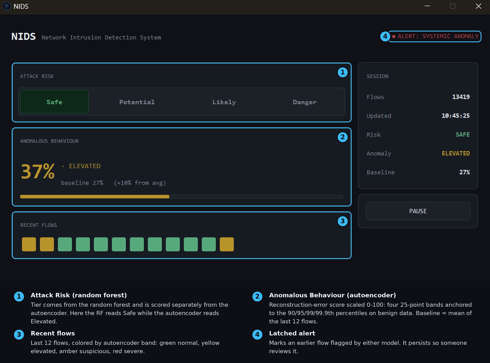

# NIDS: Network Intrusion Detection System

A real-time network intrusion detection system (NIDS) that 
continuously monitors live network traffic, extracts behavioral features, 
and uses a multi-model pipeline to identify malicious 
activity with low latency. The goal is to approximate how modern 
security platforms detect attacks in production environments.

---

## Architecture Overview
See [System Design](docs/system_design.md) for the full architecture diagram and [ADR](docs/ADR) for architecture decisions.

**ADRs were formalized on 2026-03-02 to document architectural decisions made throughout development. 
Several decisions (ADR-005→009, ADR-006→010) reflect design pivots that occur as the system evolved.*

At a high level, the system has four stages: **capture → feature extraction → inference → alerting.**

```
[Network Interface]
       ↓
[Packet Capture - LibPcap]
       ↓
[Flow Aggregator - extracts per-flow behavioral features]
       ↓
[Feature Store - multiprocessing queue]
       ↓
[ML Inference Layer]
   ├── Random Forest (supervised classifier)
   └── Autoencoder (unsupervised anomaly detector)
       ↓
[Alert Engine → SQLite log + GUI]
```

---

## How It Works

**Packet Capture:** LibPcap sniffs raw packets from the network interface and groups them into flows (bidirectional streams identified by 6-tuple: (epoch-ID, source IP, destination IP, source port, destination port, protocol).

**Feature Extraction:** Each flow is tracked in a flow table. As packets arrive, the system computes behavioral features, things like packet size statistics, inter-arrival times, flow duration, and byte ratios, that characterize how the flow behaves rather than what it contains.

**Feature Storage:** Extracted feature vectors are pushed into a shared flow-queue, enabling low-latency access across processes and multiprocess scaling.

**Inference:** Two models run on each completed flow. The Random Forest classifies the flow against known attack signatures it was trained on. The Autoencoder assigns a reconstruction-error anomaly score, catching patterns the classifier may not have seen before.

**Alerting:** Flagged flows are written to a SQLite log and surfaced in a customtkinter GUI dashboard in real time.

---

## Demos

https://github.com/user-attachments/assets/c385abda-af97-4d06-8694-1b94fa0b7c3c




## Project Structure

```
NIDS/
├── alerts/                       # Alert engine and SQLite logging
│   ├── alert_engine.py           # Orchestrates the alert across the dashboard and internal system
│   └── logger.py                 # Logs the flow and its prediction
├── capture/                      # Packet sniffing and flow tracking
│   └── capture.py
├── data/                         # Location where the logger stores the data
│   ├── nids_alerts.db            # Stores alerts in a database for easy access
│   ├── nids_alerts.log           # Stores alerts in a form to be exported to external tools
│   ├── nids_flows.db             # Stores flows for retraining and monitoring
│   ├── nids_retraining.log       # Logs retraining events (failed and succeeded)
│   └── nids_drift_check.log      # Logs drift checks and roll backs
├── datasets/                     # Training datasets (not committed, see below)
├── docs/
│   ├── ADR/                      # Architecture Decision Records
│   ├── experiment_plan.md
│   ├── feature_spec.md
│   └── system_design.md
├── evaluation/                   # Evaluates the current model based on CICIDS2017 dataset
│   ├── ae_eval.py
│   └── rf_eval.py
├── features/                     # Feature extraction logic
│   ├── extract_training.py       # Used to produce training dataframes
│   └── extract_inference.py      # Used during inference-time
├── gui/                          # customtkinter dashboard
│   ├── resources/                # Stores the logo for the dashboard 
│   ├── create_dashboard.py       # Creates the background process for the dashboard
│   └── app.py                    # Logic for the dashboard itself
├── inference/
│   └── inference.py
├── models/
│   ├── artifacts/                # model weights, biases, and dependencies (not committed - see below)
│   └── definitions/
│       ├── random_forest.py
│       └── autoencoder.py
├── scripts/
│   ├── build_dataset.py          # Used to transform the model inputs into a normalized dataset used for training
│   ├── build_dataframe.py        # Processes the raw CICIDS2017 dataframe for training
│   ├── retrain_ae.py             # Handles the logic for retraining the auto-encoder
│   └── calibrate_thresholds.py   # Calculates the thresholds for each model before they are used
├── tests/                        # in progress
├── training/
│   ├── ae_train.py
│   └── rf_train.py
├── .gitignore
├── main.py                       # Runs the standard pipeline; launches the capture, inference, and dashboard processes
├── requirements.txt              # Holds the required dependencies to be installed for the system to function
└── README.md
```
---

## Setup & Installation

### Prerequisites

- Python 3.10+ (excluding Python 3.15)
- Root/admin privileges for packet capture

### Install

```bash
git clone https://github.com/EcuspDazrt/NIDS.git
cd NIDS
pip install -r requirements.txt
```

Then, download the asset files from the release and put them in `NIDS/datasets`. 
- The pcap file is only needed for a demo
- CIC-IDS-2017 dataset is only needed for the domain adaptation feature. 
The system handles both ways you can put this folder into datasets.


### Run

#### For live-capture:
*Linux:*
```bash
# Requires elevated privileges for raw packet capture
sudo python main.py -i eth0
```
*Windows:*
Find your device's interface:
```bash
getmac /v
```
Use the transport name for either the Wi-Fi or Ethernet connection.

Then run:
```bash
python main.py -i "\Device\NPF_{YOUR-GUID-HERE}"
```

#### For PCAP-playback:

###### *If you do not enter any flag, it defaults to the pcap file committed to the repo*

*Linux:*
```bash
sudo python main.py -p "ABSOLUTE-PCAP-PATH"
```

*Windows:*
```bash
python main.py -p "ABSOLUTE-PCAP-PATH"
```

---

## Training Data

The models were trained on the **CIC-IDS-2017** dataset, a standard benchmark for network intrusion detection containing labeled benign and attack traffic across multiple attack categories (DDoS, PortScan, Brute Force, etc.).

Training data is not committed to this repo. To retrain, download the csv's at https://www.unb.ca/cic/datasets/ids-2017.html, put each of them in datasets/raw/CICIDS2017/file_name.csv, and run the system (resource intensive)

## Current Status & Roadmap

| Feature                                             | Status        |
|-----------------------------------------------------|---------------|
| Packet capture + flow aggregation                   | Working       |
| Feature extraction                                  | Working       |
| Random Forest classifier                            | Working       |
| Autoencoder anomaly detector                        | Working       |
| SQLite alert log                                    | Working       |
| GUI dashboard                                       | Working       |
| Multi-process scaling                               | Working       |
| Offline training pipeline (retraining, drift check) | Working       |
| Evaluation vs. CIC-IDS-2017 benchmark               | Working       |
| Experimentation Results                             | In Progress   |

---

## Documentation

- [Feature Specification](docs/feature_spec.md): detailed definitions of all extracted flow features
- [System Design](docs/system_design.md): architecture decisions and component breakdown
- [Architecture Decision Records](docs/ADR): log of key technical decisions and their rationale
